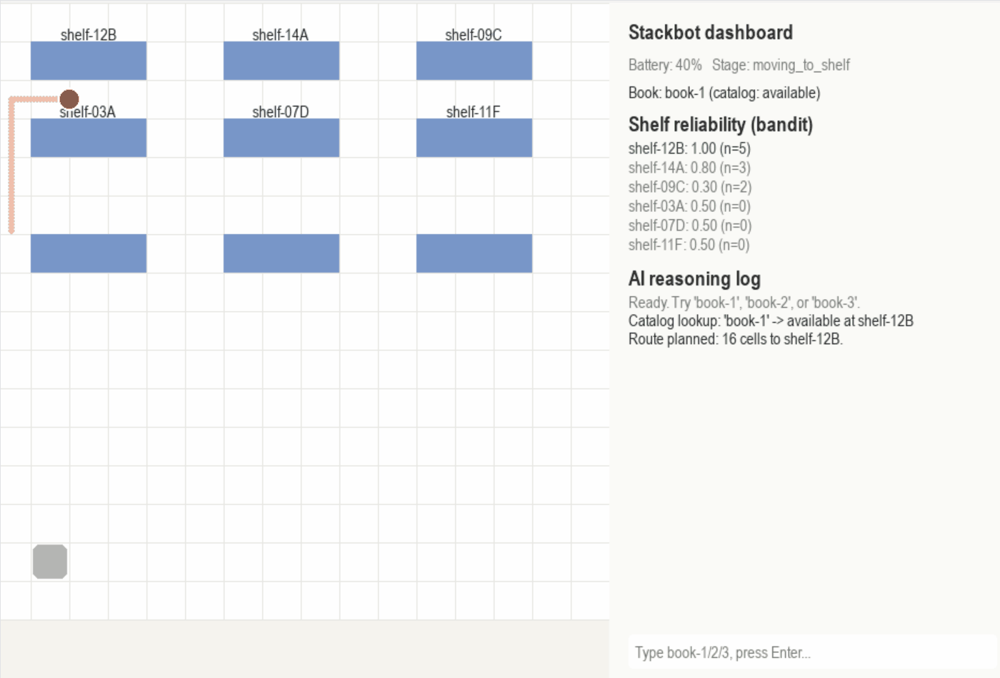

# Library Bot



This robot is a library robot project that combines several AI techniques: an LLM agent (ReAct loop) answers "is this book available?", a bandit decides how much to trust each shelf, A* plans the robot's route, and a Z3 SMT solver checks that a fetch is physically feasible. A Pygame dashboard visualises the robot.

GitHub: https://github.com/AgentsDecisionMaking-Krea/Comp-343-2026-s011

## Files

| File | Purpose |
|---|---|
| `agent.py` | ReAct loop: system prompt, JSON validation, repeated-payload detection, `MAX_TURNS` limit. Run with `available`, `unavailable` or `impossible`. |
| `verifier.py` | Z3 feasibility check (assignment, capacity, battery, battery drain). |
| `integrate.py` | `check_shelf` (multi-armed bandit over shelves) and `compare_db` (catalog vs. shelf reconciliation). |
| `digital_database.py` | SQLite catalog: books, robot state, logs (`digital_database.db`). |
| `shelves.py` | SQLite physical ground truth and per-shelf reliability (`shelves.db`). |
| `data.py` | Seeds both databases with `book-1`, `book-2`, `book-3` and `robot-1`. Run once. |
| `library_frontend.py` | Pygame dashboard (floor plan, robot animation, reliability, reasoning log). |
| `library_frontend_old.py` | Previous version of the dashboard. |
| `a_star.py` | Adapter giving the frontend a `find_path(start, goal, grid)` function. |
| `planner.py` | A* implementation (`ForkliftPlanner`). |
| `environment.py` | Grid environment used by the planner. |
| `models.py` | `Node` dataclass for A*. |
| `requirements.txt` | Python dependencies. |
| `env-setup.md` | Notes on loading the API key from `.env`. |
| `trace_*.json` | Saved agent traces for the three test cases. |

## Install

```bash
git clone https://github.com/<your-username>/<repo-name>.git
cd <repo-name>
pip install -r requirements.txt
python data.py        # setup the databases 
```

## Add your OpenAI API key

`agent.py` needs an OpenAI API key. The dashboard does not.

1. Copy the template: `cp .env.example .env`
2. Open `.env` and replace the placeholder with your own key:
   ```
   OPENAI_API_KEY=sk-your-real-key-here
   ```
   No quotes and no spaces around `=`.
3. Never commit `.env`. Make sure `.gitignore` contains `.env`. If a real key is ever committed, revoke it on the OpenAI dashboard and create a new one.

## Run

```bash
python agent.py available      # or: unavailable, impossible
python library_frontend.py     
```

In the dashboard, type a book id and press Enter. Available ids: `book-1` (Introduction to Algorithms), `book-2` (Design Patterns), `book-3` (The Art of Computer Programming).


